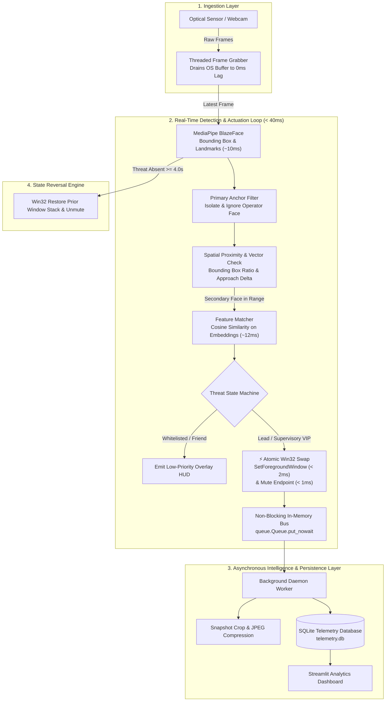

# Project CovertOps: The Academic Shield 🛡️👨‍🏫
*An Ultra-Low-Latency, Face-Aware Threat Detection and Automated Digital Camouflage System for AI Labs and Workstations.*

---

## 1. Executive Summary

In shared research facilities, computer labs, and open-plan developer environments, screen privacy is a constant challenge. Researchers and developers frequently alternate between high-focus coding, experimental benchmarks, reading, and personal tasks. 

Traditional privacy filters obstruct normal screen sharing and manual hotkeys (`Alt+Tab` or `Win+D`) suffer from human reaction delay and look conspicuously guilty.

**Project CovertOps ("Academic Shield")** is an automated, real-time computer vision and OS actuation system designed for standard workstation webcams and edge sensors. It continuously monitors the rear spatial perimeter of a workstation, distinguishes between the primary operator and approaching individuals, and categorizes them (e.g., Professor/Lead, Whitelisted Colleague, or Unknown Visitor).

When a supervisory or unverified person approaches:
1. **Instantly swaps** the active screen to an innocent, pre-cached **Decoy Application** (such as active PyTorch training terminal logs or research papers) in under **2 milliseconds**.
2. **Programmatically mutes** active media playback streams at the OS endpoint level in under **1 millisecond**.
3. **Smoothly restores** the prior workspace automatically once the visitor departs.
4. **Asynchronously logs telemetry, mugshots, and visit analytics** in the background without stealing frame-rate performance from the live camera loop.

---

## 2. Core Capabilities & Feature Set

### 🔍 Threat Classification & Spatial Awareness
* **Operator Anchoring:** The primary user (closest face to the camera) is registered as the baseline anchor. Movements, head turns, or posture adjustments by the operator never trigger the system.
* **Multi-Tier Identity Matching:**
  * **🟢 Tier 1 (Whitelisted Colleagues / Friends):** Displays a non-intrusive on-screen notification (e.g., *"Alex is behind you"*).
  * **🟡 Tier 2 (Unknown Visitors):** Halves media audio volume and pre-caches the decoy in memory.
  * **🔴 Tier 3 (Supervisory Presence / Professor / Lead):** Immediately executes the full camouflage protocol.
* **Proximity & Velocity Trigger:** Measures face bounding-box scaling and temporal deltas to trigger only when someone approaches within readable screen distance.

### 🎭 Digital Camouflage (Instant Screen Swapping)
* **Pre-Configured Decoys:**
  * **"The LLM Trainer" (Terminal):** High-speed streaming terminal output simulating an active PyTorch training loop (`[Epoch 42/100] Loss: 0.0014... CUDA Memory: 94%`).
  * **"The Diligent Coder" (IDE):** Immediately focuses and brings your designated IDE (VS Code, PyCharm) to the foreground.
  * **"The ArXiv Reader":** Automatically opens a full-screen technical research paper PDF.
* **Zero-Latency Audio Interception:** Direct Windows Core Audio API integration to mute browser/media sessions without touching physical headphones.
* **"Coast-is-Clear" Auto-Restoration:** Watches the background after an incident; once the threat has departed for a configurable cooldown (e.g., 3–5 seconds), the decoy is dismissed, and original windows/audio are restored.

### 📦 Async Telemetry & Active Learning
* **Incident Logging:** Records timestamp, visitor identity, confidence, distance proxy, dwell time, and exact reaction latency.
* **Mugshot Archive:** Cropped, high-resolution snapshots of visitors saved asynchronously to disk for post-session auditing.
* **Active Learning Tagger:** Review unknown faces in a local dashboard and assign them to whitelist or blacklist categories with one click.

---

## 3. End-to-End System Pipeline

The system decouples the time-critical **Hot Path** from the resource-intensive **Cold Path** using an asynchronous producer-consumer pattern.



### Detailed Pipeline Stages

1. **Stage 1: Asynchronous Frame Ingestion (`core/camera.py`)**  
   Standard OpenCV `VideoCapture` buffers 3–5 frames internally, creating a 100–150ms temporal lag. CovertOps resolves this by running a dedicated background thread that continuously drains the driver buffer via `grab()` and `retrieve()`, ensuring the detection loop always consumes the **exact current frame** ($< 2\text{ ms}$).

2. **Stage 2: Primary Subject Anchoring (`core/tracker.py`)**  
   The system calculates face bounding box areas and spatial coordinates. The largest face closest to the camera center is designated as the **Operator Anchor**. All subsequent processing ignores this anchor, preventing false self-triggers from operator head turns or posture shifts.

3. **Stage 3: Spatial Proximity & Approach Velocity Calculation**  
   For any detected secondary faces, the system computes:
   $$\text{Proximity Ratio} = \frac{\text{Area}_{\text{face}}}{\text{Area}_{\text{frame}}}$$
   If the ratio exceeds the configurable threshold or the temporal growth rate indicates rapid approach, the feature classifier is engaged.

4. **Stage 4: Feature Embedding & Cosine Similarity (`core/matcher.py`)**  
   Cropped secondary face regions are passed to a lightweight embedding extractor. The resulting 128-d vector $\mathbf{v}$ is matched against enrolled reference vectors $\mathbf{r}_i$:
   $$\text{Cosine Similarity} = \frac{\mathbf{v} \cdot \mathbf{r}_i}{\|\mathbf{v}\| \|\mathbf{r}_i\|}$$
   * $\text{Score} \ge 0.65$ against Supervisory references $\rightarrow$ **Trigger DEFCON 1**
   * $\text{Score} \ge 0.65$ against Colleague references $\rightarrow$ **Trigger Tier 1 (HUD alert only)**
   * Below threshold $\rightarrow$ **Trigger Tier 2 (Cautionary pre-cache)**

5. **Stage 5: Native OS Actuation (`core/os_actions.py`)**  
   To eliminate GUI latency, actuation bypasses keyboard macros (`Alt+Tab`) and calls direct Windows C-APIs:
   * **Window Focus:** `win32gui.ShowWindow` and `win32gui.SetForegroundWindow` swap windows in $< 2\text{ ms}$.
   * **Audio Attenuation:** Direct Windows Core Audio COM API (`IAudioEndpointVolume`) mutes playback in $< 1\text{ ms}$.

6. **Stage 6: Non-Blocking Event Offloading (`core/event_queue.py`)**  
   The hot loop dumps `(frame_copy, timestamp, bbox, classification)` into a Python thread-safe in-memory queue using non-blocking `.put_nowait()`. This operation takes microseconds, keeping the camera loop at 60 FPS.

7. **Stage 7: Background Intelligence & Persistence (`background/worker.py`)**  
   The cold-path worker thread extracts high-resolution face crops, writes compressed JPEGs to `data/snapshots/`, and commits event telemetry into SQLite.

8. **Stage 8: Departure Verification & Workspace Restoration**  
   When the secondary face disappears for a continuous cooldown window (default: $4.0\text{ seconds}$), the system smoothly brings the original workspace back into focus and restores pre-event audio volume.

---

## 4. Latency Budget Analysis

Human walking speed averages $1.2 - 1.4\text{ m/s}$. Approaching from the rear gives a workstation operator approximately $1.5 - 2.5\text{ seconds}$ before screen text becomes legible. 

By maintaining a total system trigger latency of **under 45 milliseconds**, CovertOps executes the defense mechanism before the approaching subject's eyes can focus on the display.

### Latency Comparison Breakdown

| Pipeline Stage | Naive Approach (Slow & Unoptimized) | CovertOps Pipeline (Optimized) | Engineering Rationale |
| :--- | :--- | :--- | :--- |
| **1. Frame Acquisition** | $120 - 160\text{ ms}$ (OS buffer lag) | **$2 - 4\text{ ms}$** | Dedicated double-buffer thread |
| **2. Face Detection** | $80 - 120\text{ ms}$ (Heavy CNN) | **$8 - 12\text{ ms}$** | MediaPipe BlazeFace (CPU-optimized) |
| **3. Face Recognition** | $180 - 250\text{ ms}$ (Dlib every frame) | **$12 - 16\text{ ms}$** | Event-triggered MobileFaceNet ONNX |
| **4. Window Actuation** | $80 - 120\text{ ms}$ (`pyautogui` key events) | **$< 2\text{ ms}$** | Native Win32 `SetForegroundWindow` C-API |
| **5. Audio Attenuation** | $40 - 60\text{ ms}$ (Simulated media keys) | **$< 1\text{ ms}$** | Direct COM `IAudioEndpointVolume` hook |
| **TOTAL RESPONSE TIME** | **$500 - 710\text{ ms}$ (Noticeable lag)** | **$25 - 45\text{ ms}$ (Instantaneous)** | **Guaranteed real-time protection** |

---

## 5. Technology Stack

| Layer | Technology | Version | Justification |
| :--- | :--- | :--- | :--- |
| **Core Vision** | `mediapipe` (BlazeFace) | $\ge 0.10.0$ | Sub-10ms face detection on standard CPU without requiring heavy CUDA setup. |
| **Frame Processing** | `opencv-python` | $\ge 4.8.0$ | High-throughput matrix operations, frame scaling, and color space transformations. |
| **OS Windowing** | `pywin32` | $\ge 306$ | Direct C-level Win32 API access (`SetForegroundWindow`, `ShowWindow`) for sub-2ms window swaps. |
| **Audio Control** | `pycaw` & `comtypes` | $\ge 20240210$ | Native Windows Core Audio Endpoint COM interface for instant zero-latency mute. |
| **Array Math** | `numpy` | $\ge 1.24.0$ | Vectorized cosine similarity distance calculations and coordinate bounding math. |
| **Persistence** | `sqlite3` | Built-in | Embedded relational database for zero-overhead local telemetry logging. |
| **Image Archival** | `pillow` | $\ge 10.0.0$ | Non-blocking snapshot compression and cropping. |
| **Backend API** | `fastapi` & `uvicorn` | $\ge 0.100.0$ | High-throughput asynchronous REST API serving telemetry and snapshots to the frontend. |
| **Frontend Dashboard** | `React` + `Vite` + `Tailwind` | $\ge 18.0.0$ | Sleek, modern dark-mode UI with live incident feeds, latency metrics, and mugshot gallery. |

---

## 6. Complete Project File Structure

```text
IOT/
├── README.md                      # System documentation & technical specification
├── WORK_DISTRIBUTION.md           # 4-Member roles and individual task breakdown
├── config.py                      # Global parameters, thresholds, and decoy options
├── main.py                        # System orchestrator & hot-loop runtime
├── enroll.py                      # Face enrollment CLI (records reference embeddings)
├── requirements.txt               # Python package dependencies
│
├── core/                          # ⚡ FAST PATH (Low-Latency Hot Loop - Zero Disk I/O)
│   ├── __init__.py
│   ├── camera.py                  # Threaded non-blocking webcam frame grabber
│   ├── detector.py                # MediaPipe BlazeFace detection wrapper
│   ├── tracker.py                 # Primary user anchoring & secondary face logic
│   ├── matcher.py                 # Cosine similarity face embedding comparator
│   ├── os_actions.py              # Native Win32 window switcher & audio controller
│   └── event_queue.py             # Thread-safe in-memory communication bus
│
├── background/                    # 📦 COLD PATH (Async Processing & Persistence)
│   ├── __init__.py
│   ├── worker.py                  # Background thread consuming event queue
│   ├── database.py                # SQLite telemetry schema & event logging
│   └── storage.py                 # Async image cropper & disk snapshot archiver
│
├── backend/                       # 🌐 REST API (Serves Dashboard)
│   ├── __init__.py
│   └── api.py                     # FastAPI server exposing incidents & telemetry
│
├── decoys/                        # 🎭 Decoy Applications
│   ├── __init__.py
│   ├── terminal_sim.py            # Simulated PyTorch/LLM matrix training terminal
│   └── static/                    # Technical research papers and static decoy assets
│
├── dashboard/                     # ⚛️ Modern Frontend (React + Vite + Tailwind CSS)
│   ├── package.json
│   ├── vite.config.js
│   ├── src/
│   │   ├── App.jsx                # Main dashboard view (live feed, metrics, gallery)
│   │   ├── components/            # IncidentCard, MetricWidget, FaceTaggerModal
│   │   └── ...
│
└── data/                          # 💾 Local Persistent Storage (Git-Ignored)
    ├── known_faces/               # Reference face directories
    │   ├── me/                    # Primary user reference embeddings
    │   ├── threats/               # Supervisory profiles (Supervisors, Leads)
    │   └── friends/               # Whitelisted colleague profiles
    ├── snapshots/                 # Captured cropped visitor photos
    └── telemetry.db               # SQLite database file
```

---

## 7. Background Telemetry Database Schema

Stored locally in `data/telemetry.db`:

```sql
CREATE TABLE IF NOT EXISTS security_incidents (
    incident_id INTEGER PRIMARY KEY AUTOINCREMENT,
    timestamp DATETIME DEFAULT CURRENT_TIMESTAMP,
    classification TEXT NOT NULL,         -- 'LEAD_SUPERVISOR', 'COLLEAGUE', 'UNKNOWN'
    subject_name TEXT,                    -- Resolved identity if matched
    similarity_score REAL,                -- Cosine similarity coefficient (0.00 - 1.00)
    proximity_ratio REAL,                 -- Normalized face-to-frame bounding ratio
    detection_latency_ms REAL,            -- System response time from frame ingestion to swap
    dwell_duration_seconds REAL,          -- Duration the subject remained in range
    snapshot_path TEXT                    -- File path of the cropped artifact
);

CREATE TABLE IF NOT EXISTS telemetry_diagnostics (
    sample_id INTEGER PRIMARY KEY AUTOINCREMENT,
    timestamp DATETIME DEFAULT CURRENT_TIMESTAMP,
    loop_fps REAL,                        -- Actual runtime frame rate
    cpu_utilization_pct REAL,             -- CPU load during active inference
    ram_usage_mb REAL                     -- Working set memory allocation
);
```

---

## 8. Setup & Installation

### Prerequisites
* Windows 10/11 64-bit
* Python 3.10+
* Standard Laptop Webcam or USB optical sensor

### Installation Steps

```bash
# 1. Clone repository and navigate to root directory
cd IOT

# 2. Install dependencies
pip install -r requirements.txt

# 3. Enroll baseline identity (Operator)
python enroll.py --category me --name "Operator"

# 4. Enroll supervisory reference (Lead / Supervisor)
python enroll.py --category threats --name "Supervisor_Lead"

# 5. Launch the defense pipeline
python main.py

# 6. Launch the backend API (separate terminal)
uvicorn backend.api:app --port 8000 --reload

# 7. Launch the React dashboard (separate terminal)
cd dashboard
npm install
npm run dev
```

