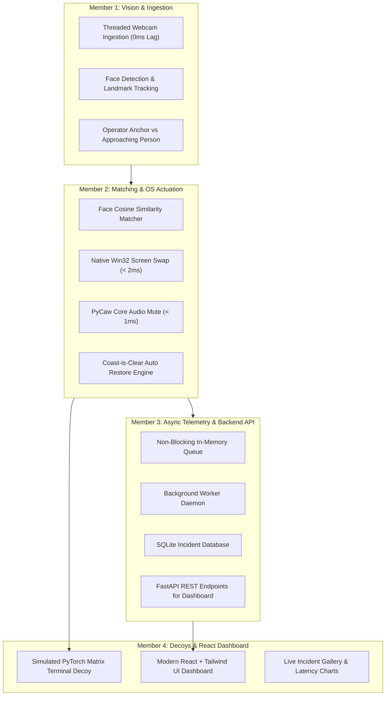

# Project CovertOps: 4-Member Work Distribution & Task Blueprint 👥💻
*Real-Time Threat Detection & Workstation Camouflage — Local Laptop System*

---

## 1. System Pipeline Overview



---

## 2. 4-Member Work Distribution Matrix

| Member | Primary Ownership | Core Modules | Key Deliverables |
| :--- | :--- | :--- | :--- |
| **Member 1** | **Computer Vision & Ingestion** | `core/camera.py`<br>`core/detector.py`<br>`core/tracker.py` | Zero-buffer frame grabber, 60 FPS face detector, operator anchor & proximity tracking |
| **Member 2** | **Threat Matching & OS Actuation** | `core/matcher.py`<br>`core/os_actions.py`<br>`enroll.py` | Cosine similarity face matcher, sub-2ms Win32 window swap, audio mute, and auto-restore |
| **Member 3** | **Async Telemetry & Backend API** | `core/event_queue.py`<br>`background/worker.py`<br>`background/database.py`<br>`backend/api.py` | Non-blocking queue, SQLite telemetry persistence, snapshot archiver, and FastAPI REST endpoints |
| **Member 4** | **Decoy Applications & React Dashboard** | `decoys/terminal_sim.py`<br>`dashboard/` (React + Tailwind) | High-speed fake training terminal, sleek dark-mode React dashboard, and incident gallery |

---

## 3. Dedicated Task Breakdown by Member

### 🧑‍💻 Member 1: Computer Vision & Ingestion Lead
* **Threaded Video Ingestion (`core/camera.py`):**
  * Implement a dedicated daemon thread continuously calling `cap.grab()` and `cap.retrieve()` on webcam index `0` to drain the OS buffer and achieve 0ms lag.
* **Real-Time Face Detection (`core/detector.py`):**
  * Integrate Google MediaPipe BlazeFace (or lightweight OpenCV Haar/DNN) running on CPU at 30–60 FPS.
* **Operator Anchoring (`core/tracker.py`):**
  * Anchor on the primary operator (largest, centered face) and filter out operator head turns, yaw, and posture shifts.
* **Proximity & Velocity Tracker:**
  * Calculate the normalized bounding-box area ratio of any secondary face appearing in the background and compute approach velocity ($\Delta \text{Area} / \Delta t$).

---

### 🛡️ Member 2: Threat Matching & OS Actuation Lead
* **Facial Embedding & Cosine Similarity (`core/matcher.py`):**
  * Extract 128-d face embeddings and compute cosine similarity against stored vectors in `data/known_faces/`.
* **Face Enrollment CLI (`enroll.py`):**
  * Build a quick script to capture and save reference face embeddings for the operator (`me/`), supervisors (`threats/`), and colleagues (`friends/`).
* **Sub-2ms Window Swapping (`core/os_actions.py`):**
  * Implement native Windows C-API window manipulation (`win32gui.ShowWindow` and `win32gui.SetForegroundWindow`) to bring the decoy instantly to the foreground.
* **Sub-1ms Audio Attenuation (`core/os_actions.py`):**
  * Interface with Windows Core Audio via `pycaw` (`IAudioEndpointVolume`) to mute media sessions with zero latency.
* **Auto-Restoration State Machine:**
  * Track threat departure; when the secondary face is absent continuously for 4 seconds, minimize the decoy and restore the prior window stack and volume.

---

### 📊 Member 3: Asynchronous Telemetry & Backend API Lead
* **Non-Blocking In-Memory Bus (`core/event_queue.py`):**
  * Implement a thread-safe `queue.Queue` with non-blocking `.put_nowait()` so the camera loop never waits on disk writes.
* **Background Consumer Daemon (`background/worker.py`):**
  * Worker thread consuming incident payloads from the queue, cropping visitor faces, and writing compressed JPEGs to `data/snapshots/`.
* **Database Architecture (`background/database.py`):**
  * Create and maintain `telemetry.db` (SQLite schema logging timestamps, threat classification, reaction latency in ms, dwell time, and snapshot paths).
* **FastAPI Backend Server (`backend/api.py`):**
  * Build lightweight REST API endpoints to serve data to Member 4's React dashboard:
    * `GET /api/incidents` — List all logged incidents with pagination and filters.
    * `GET /api/metrics` — Aggregate latency statistics (P50, P95, P99 in ms) and total triggers.
    * `GET /api/snapshots/{filename}` — Serve cropped visitor images.
    * `POST /api/tag-face` — Reclassify an unknown face as friend or threat.

---

### 🎨 Member 4: Decoy Applications & React Dashboard Lead
* **PyTorch Matrix Training Decoy (`decoys/terminal_sim.py`):**
  * Full-screen realistic terminal application streaming dynamic PyTorch loss logs, learning rates, and GPU memory metrics at 400 lines/second.
* **Modern React Dashboard (`dashboard/`):**
  * Built using **React + Vite + Tailwind CSS** (sleek, high-tech dark theme).
* **Dashboard Features:**
  * **Live Incident Feed:** Timeline showing when someone approached your workstation.
  * **"Hall of Lurkers" Gallery:** Card grid displaying cropped snapshots of detected visitors with timestamps and threat badges.
  * **System Telemetry Cards:** Real-time metrics displaying P50/P95 latency in ms, total triggers today, and average dwell time.
  * **Interactive Face Tagger:** Quick action button on any unknown face card to immediately categorize them as "Supervisor" or "Friend".

---

## 4. Software Interface Contract

```python
# 1. Member 1 outputs to Member 2:
detection_payload = {
    "frame": current_frame,
    "operator_found": True,
    "secondary_face_detected": True,
    "secondary_bbox": (x, y, w, h),
    "timestamp": time.time()
}

# 2. Member 2 executes OS actions, then offloads to Member 3:
incident_payload = {
    "timestamp": time.time(),
    "threat_type": "LEAD_INCOMING",
    "reaction_latency_ms": 32.5,
    "frame_crop": cropped_visitor_face
}
event_queue.put_nowait(incident_payload)

# 3. Member 3 serves SQLite data to Member 4 via FastAPI JSON:
# GET /api/incidents -> [
#   {
#     "id": 1,
#     "timestamp": "2026-10-28 14:22:05",
#     "threat_type": "LEAD_INCOMING",
#     "latency_ms": 32.5,
#     "snapshot_url": "/api/snapshots/incident_1.jpg"
#   }
# ]
```
